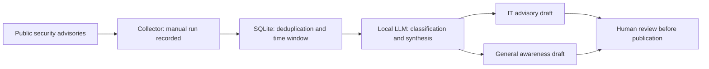

# AI-Assisted Security Advisory Digest

**POC & Future Design Study**

A small implemented POC that collects public security advisories, uses SQLite for deduplication and time-window handling, and asks a local LLM to classify items and draft two digests: one for IT staff and one for general colleagues. Human review remains the publication gate.

**Status:** One successful manual execution is recorded. Automated scheduling has no completed-run evidence. Security Log analysis is a separate, unimplemented design study.

已完成的是公開資安情報整理與兩份人工審核草稿的 POC。EDR、SIEM／SOC、主機 Log、網路監控、AI 異常偵測及自動處置均未實作。

## Engineering Highlights

- **Public-source ingestion:** documented handling of source-access restrictions without bypassing them.
- **Bounded processing:** SQLite deduplication, a 14-day source window, and batched LLM classification.
- **Audience-specific drafts:** technical advisories and general awareness content, with human review before release.
- **Evidence discipline:** 237 archived source items with a 197/40 database-state split; no delivery-rate or AI-accuracy interpretation.

## Implemented POC Architecture

This is a logical workflow, not an internal network or asset map. The POC generates drafts; it does not operate security devices or automatically publish content.

## Recorded Results and Limits

| Observation | Meaning | Limit |
|---|---|---|
| One successful manual run | Advisory processing and draft artifacts recorded | Not long-term source stability or scheduled reliability |
| 237 items; state counts 197 and 40 | Archived database-state distribution | Not message delivery, precision, recall, or validated relevance |
| Two audience-specific drafts | IT and general-colleague drafts produced | No retained human-scored correctness or usefulness evaluation |
| Schedule configuration | Planned twice-monthly execution described | No completed automatic-run record |

The source window may delay or omit important items. Source completeness, missed items, citations, and model output need human checking. No accuracy, detection effectiveness, saved-hours, or delivery-success claim is made.

## Future Design Study — Not Implemented

The [Design Study](docs/DESIGN_STUDY.md) separates the POC's engineering decisions from a proposed read-only security-event analysis architecture. EDR, SIEM/SOC, host-log collection, network monitoring, AI anomaly detection, and automated response are not implemented or validated.

## My Contributions / AI-Assisted Engineering

**Project Owner:** defined the two audiences and requirements, selected architecture and processing cadence, required human review, and reviewed recorded outputs.

**Claude Code:** implemented recorded collection, deduplication, prompts, LLM integration, containerization, and schedule configuration; investigated source and model behavior. Configuration is not proof of successful scheduled operation.

**Codex:** prepared this documentation from the de-identified handoff, without collecting new advisories or running the POC. The owner did not personally write most of the implementation.

## Reproducibility and Public Scope

This candidate contains de-identified documentation only. No enterprise asset inventory, advisory draft originals, source code, logs, credentials, or deployment settings are provided. The archived run cannot be independently reproduced from these files alone; no open-source license or third-party publication authorization is asserted.
