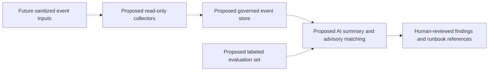

# Security Advisory Digest — POC Decisions & Future Design Study

## Evidence and Maturity

The supplied de-identified handoff records one successful manual run of public-advisory collection and AI-assisted digest drafting. This portfolio work did not rerun collection or independently inspect the original database and outputs.

The archived database contains 237 source items with a 197/40 state split. These are stored states, not independently verified messages delivered or labels judged correct. Two audience-specific drafts were produced. Automated execution, long-term source stability, content quality, and relevance accuracy remain unverified.

本文件分開描述已實作的小型 POC 與尚未實作的未來架構。封存資料庫狀態、單次成功與排程設定，都不能轉換成送達率、準確率或正式服務可用性。

## Implemented POC: Three Engineering Decisions

### 1. Respect Source Access Restrictions

**Problem:** An official feed rejected automated access; another source endpoint was outdated.

**Recorded response:** Use an accessible public JSON alternative with a dedicated parser, and update the obsolete endpoint rather than bypass access controls.

**Outcome:** The recorded manual run ingested items from four sources. This establishes single-run ingestion, not stable long-term collection.

**Limit:** Completeness and update delay of alternative sources were not monitored. No exact endpoints, original advisories, or organization-specific product details are disclosed.

### 2. Bound Historical Ingestion and Model Work

**Problem:** Historical advisories expanded the input volume and made per-item model processing impractical.

**Decision:** Apply a 14-day window, classify in batches of 20, and synthesize two audience drafts instead of drafting separately for every item. The planned cadence changed to twice monthly.

**Outcome:** A single manual run completed and produced the two drafts. Schedule configuration exists, but a completed automated run is not recorded.

**Limit:** The time window and cadence trade freshness for workload control. There is no missed-advisory statistic, runtime benchmark, or repeatability measurement. The 197/40 state split cannot establish relevance accuracy.

### 3. Treat Model Output as a Draft, Not an Operational Decision

**Problem:** Reasoning-heavy model responses could leave the answer field empty; generated prose also used assumptions that required human correction.

**Recorded adjustment:** Lower reasoning effort, adjust output limits, and add handling for empty answer content. Produce explicitly labeled drafts for manual review.

**Outcome:** Draft artifacts exist from the manual run. No quality evaluation or guarantee of model behavior across revisions is available.

**Limit:** Fallback output must still be reviewed. Human review reduces exposure but does not prove prompt-injection resistance, factual accuracy, or valid citations. Dedicated testing and content assessment remain future work; no current attack surfaces or operating details are published.

## What Is Not Implemented

| Capability | Status |
|---|---|
| EDR or equivalent host observation | Not implemented |
| SIEM / SOC platform or event correlation | Not implemented |
| Host-log collection and centralized event storage | Not implemented |
| Network-device or traffic monitoring | Not implemented |
| AI anomaly detection | Not implemented; no evaluation set or detection metric |
| Automated incident response | Not implemented |
| Completed automatic digest execution | No run evidence |

The advisory POC is not a deployed security-monitoring platform. Receiving public advisories does not demonstrate intrusion detection or response capability.

## Future Architecture — Design Only

The following is a generic proposal, not a description of any current enterprise environment. It prioritizes data governance and evaluation before AI integration.

All components and connections in this diagram are unimplemented. It does not imply deployed agents, tested throughput, event coverage, or effectiveness.

| Design choice | Rationale | Required validation before a capability claim |
|---|---|---|
| Define event sources and retention first | AI analysis requires dependable, governed data | Coverage, privacy review, retention policy, and access controls |
| Separate collection and analysis permissions | Limit the consequences of a compromised component | Permission tests, read-only guarantees, and integrity controls |
| Restrict AI to summaries and suggestions | Keep operational decisions with people | Factuality, safe citations, injection testing, and reviewer acceptance |
| Build a labeled evaluation set | Make error rates assessable | Defined labels, representative examples, and precision/recall methodology |
| Reference approved runbooks | Avoid invented remediation procedures | Review, ownership, and versioned procedures |
| Plan inference load limits | A shared inference resource needs a capacity policy | Load tests and scheduling observations |

None of these proposed controls is presented as an implemented security feature. No automated blocking or equipment modification is part of the proposal.

## Roles, Reproducibility, and Publication Boundary

The Project Owner defined audiences, requirements, architecture direction, cadence, and human-review policy and reviewed outputs. Claude Code wrote the recorded POC and integrations and investigated failures. Codex organized the supplied handoff into this documentation; no security collection, benchmark, or deployment was executed.

Exact model revision, a complete environment specification, independent output assessment, and scheduled-run evidence are not available in the supplied handoff. Backup and recovery validation, source monitoring, credential lifecycle review, and operational hardening require private follow-up.

This document includes no enterprise names, internal assets or topology, equipment versions, original advisories or drafts, vulnerability conclusions about an organization, private logs, or secrets. Original materials remain outside the candidate. Publication rights still require project-specific owner review; no company authorization or open-source license is inferred. See the [project overview](../README.md).
